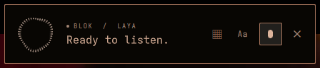
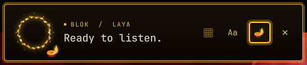
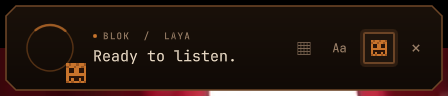
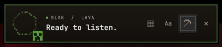
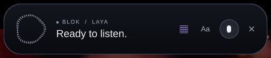

# BLoK

**An offline Jarvis for Hyprland: it hears you, sees your screen, clicks, and talks back. No cloud, no API keys.**

Tap <kbd>Ctrl</kbd>+<kbd>.</kbd> (or the mic) and talk the way you normally talk. BLoK stops listening by itself when you pause, like a phone assistant, so there's nothing to hold or click again. Holding the key while you speak works too. BLoK opens apps and sites, searches, plays music and videos, finds and edits your files, controls windows, volume and brightness, clicks the button you're pointing at, and tells you what it did. Speech recognition, decisions and the voice all run on your own computer.

<p align="center">
  <br>
  
  <br>
  
  
</p>

## Install

```sh
curl -fsSL https://raw.githubusercontent.com/samashech/BLoK/main/install.sh | bash
```

The installer checks your system packages, then lets you pick models and shows their sizes before downloading anything:

| Part | Choices | Download |
|---|---|---|
| Decisions (Laya, required) | — | ~820 MB |
| Speech recognition (Whisper) | base.en / **small.en** / medium.en | 145 MB / **465 MB** / 1.5 GB |
| Voice (Kokoro) | **full** / compact / espeak only | **340 MB** / 115 MB / 0 |
| Rephraser (Qwen2.5 3B via Ollama, optional) | yes / **no** | 1.9 GB / 0 |
| Python packages | — | ~1.2 GB |

`--minimal` and `--full` pick for you; `--yes` takes the recommended (bold) choices. From a clone: `./install.sh`. An AUR package (`blok-git`, then `blok setup`) is ready in [`packaging/aur`](packaging/aur).

Then load the browser extension once: `brave://extensions` → Developer mode → **Load unpacked** → the `browser-extension` folder. Requirements: Arch Linux with Hyprland (built and tested on Omarchy), PipeWire, and Brave or another Chromium browser for web control.

## Talk to it

You don't need to phrase things properly. Fillers, stutters, slang and mid-sentence corrections are fine.

| You say | BLoK does |
|---|---|
| “hey man, open spotify or something” | opens Spotify |
| “yo can u look up reddit for me” | opens Reddit (and “look up how to cook pasta” searches Google) |
| “open youtube” … “get me a pewdiepie video” | plays one, in the same tab |
| “open steam” … “search for phantom blade” | searches Steam, because that's the page in front of you |
| *(pointing with the mouse)* “click that button” | clicks what you're pointing at; asks first if it says delete, buy or pay |
| “find my resume pdf” … “open it” | finds it in your home folder, then opens it |
| “add buy milk to my todo file” | appends the line |
| “delete old.txt” | moves it to the trash, after you approve |
| “it's way too loud” · “make the screen dimmer” | volume down · brightness down |
| “put this window on workspace three” | moves it |
| “uh what day is it today?” | tells you, out loud |
| “download supertux” | finds the official page, picks the download link, asks, downloads |
| “make it spooky” | switches to the Halloween theme |

Anything that changes or deletes something, or that BLoK isn't sure about, shows an approval card first. Say “yes” or press Enter to approve; say “no” or press Esc to cancel.

## It can read your screen

No GPU and no screenshots sent anywhere: in the browser BLoK reads the page's own text through the extension; in other apps it captures just the focused window and reads it with Tesseract OCR (about a second).

| Say | Does |
|---|---|
| “what's this page about?” · “summarize this” | a two- or three-sentence summary |
| “read this to me” | reads the article, or your selected text, aloud; “stop” ends it |
| “what does this error mean?” (in a terminal or editor) | finds the error on screen and explains it |
| “what's the price here?” · “on this page, who wrote it?” | answers from the page |
| “click the blue Download button” | the color picks between same-named buttons |
| “click Save” in an app without accessibility labels | finds the word on screen and puts the pointer on it (clicks too if `ydotool` is installed) |

With Ollama running, the local Qwen model writes the summaries and explanations; without it BLoK picks the most relevant sentences and recognises prices, dates, emails and phone numbers. Screen text is never stored. In Hinglish: “ye page kis baare mein hai”, “padh ke sunao”, “ye error kya hai”.

## Your windows, by voice

BLoK speaks Hyprland, so it can arrange your desktop, not just open apps.

| Say | Does |
|---|---|
| “code on the left, browser on the right” | puts both side by side on a free workspace |
| “save this layout as coding” … later “coding mode” | remembers every window's app, workspace and position, then restores it, reopening apps that were closed |
| “focus for 25 minutes” · “deep work” | silences notifications and hides chat apps (Discord, Slack, Telegram…) until the timer ends or you say “I'm done” |
| “where's my terminal?” · “what's on workspace 3?” | tells you |
| “close everything except code” | closes the rest of this workspace, after you approve the list |
| “list my layouts” | names your saved setups |

Layouts live in `~/.config/blok/layouts/` as plain JSON you can edit. Focus mode hides apps matching `BLOK_FOCUS_HIDE` (a regex of window classes) and puts everything back exactly where it was. In Hinglish: “focus mode chalu karo”, “code left mein aur browser right mein rakho”, “coding layout lagao”.

## Hinglish

BLoK understands everyday Hinglish and answers the same way, in a Hindi voice:

| You say | BLoK does |
|---|---|
| “YouTube pe Arijit ke gaane chalao” | plays Arijit Singh songs on YouTube |
| “bhai zara spotify khol do” · “downloads folder kholo” | opens them |
| “awaaz thoda badhao” · “brightness kam karo” | volume up · brightness down |
| “kitne baje hain?” | *“Abhi 3 baj kar 20 minute hue hain”* |
| “youtube kholo aur phir minecraft search karo” | both, in order |
| “numbers dikhao” … “barah pe click karo” | hands-free clicking |
| “haan” / “nahi, rehne do” | approves or cancels |

Spoken Hinglish needs the multilingual Whisper model (installer option 4, 465 MB, same speed as the English one). It's about as accurate at English, and it's used automatically when installed. Typed Hinglish and Devanagari work with any model.

## Hands-free

Say **“hands free on”** (or run `blok handsfree on`) and BLoK listens for its name; no keyboard needed. Start with **“hey block”**, then keep going for 8 seconds without repeating it.

| Say | Does |
|---|---|
| “hey block, show numbers” | numbers every link, button and field on the page |
| “12” · “open 4 in a new tab” | clicks number 12 (fields get selected) · opens a link in a new tab |
| “type hello world” · “press tab” · “press enter” | types into the selected field · presses keys, in any app |
| “scroll down” · “scroll up a little” · “go to the top” | scrolls the page, or the app in front |
| “hide numbers” · “hands free off” | clears the numbers · stops listening |

It costs almost no CPU while waiting (Whisper runs only when someone speaks), never records to disk, and pauses while BLoK talks. Numbers, page reading and teaching need the browser extension updated to `phase11`: reload it in `brave://extensions`, then reload open pages.

## Teach it by showing

No scripts: show BLoK a browser task once and it can do it again by name.

1. Open the page where the task starts and say **“watch me”**.
2. Do it: click, type, press Enter. BLoK records each control by its label and role, not screen positions, and never reads password fields.
3. Say **“done, call it file an expense”**.

Later, **“file an expense, amount 900, note team dinner”** replays it: it opens the starting page, finds each control again, types your new values (fields you don't mention keep what you typed while teaching) and stops at the first step that doesn't match. Skills that click things like *Pay*, *Buy*, *Submit* or *Delete* ask for approval first. “list my skills” and “forget file an expense” manage them; they're plain JSON in `~/.config/blok/skills/`. In Hinglish: “dekho main kaise karta hun” … “iska naam kharcha rakho”.

## Let AI apps use your desktop (MCP)

BLoK is also an [MCP](https://modelcontextprotocol.io) server, so Claude and other AI apps can drive your Hyprland desktop through BLoK's safety layer.

```sh
claude mcp add blok -- blok mcp          # Claude Code
```

For Claude Desktop or any other MCP client, add a server whose command is `blok mcp` (stdio). BLoK must be running.

It offers 23 tools: `blok_command` (any plain-English command, as you'd say it), window and layout control, focus mode, file find/read/append/create, browser open/search/read/click, typing, volume, brightness, media and `say`.

**You stay in control:** anything that changes things or hands your data to the AI (reading files, pages or the screen, typing, clicking, writing files, restoring layouts, running a command) shows BLoK's approval card on your screen, naming the app and what it wants to do. Only you can approve, by voice, Enter or a click; the AI app has no way to. Opening sites, searching, arranging windows, volume and brightness run without asking. Tool calls go through a socket only your user can open (`$XDG_RUNTIME_DIR/blok.sock`).

## Make it yours

### Add a command in 30 seconds

Drop a file in `~/.config/blok/commands/`. It works on the next thing you say; no restart needed.

```toml
# ~/.config/blok/commands/transparency.toml
description = "Toggle window transparency"
phrases = ["toggle transparency", "make [the] windows see through", "solid windows"]
run = "omarchy-hyprland-window-transparency-toggle"
reply = "Toggled transparency"
```

`[words]` are optional and `{slot}` captures part of what you said (passed safely quoted). For anything more involved, write Python:

```python
# ~/.config/blok/commands/dice.py
import random
from blok.plugins import command

@command("Roll a dice", phrases=["roll a dice", "roll a {sides} sided dice"])
def roll(sides="6"):
    return f"You rolled {random.randint(1, int(sides))}."
```

Exact phrases run instantly; looser wording is routed to your commands by Laya. `blok commands` lists what's loaded and reports broken files. See [`commands/`](commands) for the bundled examples (screenshot, wallpaper, color picker, QR code, gaps, timers).

### Make a theme pack

A theme is a folder with a `theme.json` and any images it uses. Put it in `~/.config/blok/themes/<name>/` and click ▦ to cycle to it. See [`themes/README.md`](themes/README.md) for every field; the shipped [`themes/`](themes) are good starting points. Packs can use a ring style (`sparks`, `arc`, `pixels`), a corner badge and mic icon (emoji, a built-in pixel sprite, or your own PNG/SVG), cut corners, a pixel border and a glow.

Built-in themes: **Omarchy** (follows your desktop palette), **Liquid**, **Diwali**, **Halloween** and **Minecraft**.

## How it works

```
Ctrl+. ─► Whisper (local) ─► speech cleanup ─► rules ──────────────► plan ─► act ─► verify ─► Kokoro voice
                                               └─► Qwen rephrase* ─► Laya ─┘      (browser / desktop / files)
```

- **Hearing:** PipeWire records while you hold the key; [faster-whisper](https://github.com/SYSTRAN/faster-whisper) transcribes in about a second on a laptop CPU.
- **Understanding:** fast rules handle clear requests. Everything else goes to [Laya](https://github.com/NandhaKishorM/laya), a small local decision model that chooses among concrete actions (area first, then action) and never writes code or shell commands. An optional local Qwen model only *rephrases* rambling speech; Laya still decides.
- **Acting:** a browser extension drives your real, signed-in tabs (observe → act once → verify); desktop actions use Hyprland and Omarchy's own commands; file actions stay inside your home folder.
- **Seeing:** before each command BLoK checks which window and page are in front, so follow-ups like “search for …” and “click that” mean what you'd expect.
- **Talking:** [Kokoro-82M](https://huggingface.co/hexgrad/Kokoro-82M) speaks the result; ElevenLabs is optional (`blok elevenlabs-key`) and espeak is the fallback.

## Settings

| Variable | Effect |
|---|---|
| `BLOK_WHISPER_MODEL` | Speech model folder or name (default: the installed size, small.en preferred) |
| `BLOK_KOKORO_VOICE` / `BLOK_KOKORO_SPEED` | Voice (`af_heart`, `am_michael`, `bm_george`, …) and pace |
| `BLOK_TTS=0` | Silence spoken replies (`blok voice off` does the same) |
| `BLOK_REPHRASE=0` / `BLOK_REPHRASE_MODEL` | Turn off or choose the Ollama rephraser |
| `BLOK_END_SILENCE` | Pause (seconds, default 1.0) that ends a command |
| `BLOK_STT=voxtype` | Use a running Voxtype daemon instead of built-in Whisper |
| `BLOK_HOME` / `BLOK_DATA` | Where models, the Python environment and your data live |
| `BLOK_REDUCED_MOTION=1` | No reveal or ring animation |

BLoK ends a recording about a second after you stop talking; set `BLOK_END_SILENCE` (seconds) if it cuts you off mid-thought or waits too long. If you say nothing, it gives up after 7 seconds. While you talk, the orb follows your voice.

Names Whisper gets wrong (artists, games, friends) go one per line in `~/.config/blok/words.txt`. If recognition is poor, run `blok mic-test`: it shows your input level and exactly what Whisper heard.

## Privacy and safety

- Everything runs locally. Nothing you say leaves your computer unless you turn on ElevenLabs, which only receives the reply text.
- Recordings live in a private runtime folder and are deleted right after transcription.
- The browser extension only acts when you ask, and only remembers where your mouse is on the current page.
- File actions never touch hidden folders or overwrite files, and deleting goes to the trash. BLoK can't install packages, shut down your computer, or send or upload anything.

## Commands

```sh
blok                 # show the overlay       blok commands     # list your commands
blok mic-test        # check your microphone  blok theme diwali # switch theme
blok setup           # choose/download models blok voice off    # mute replies
blok text "open youtube"                      # type instead of talking
scripts/slim.sh      # see what disk space can be reclaimed (changes nothing without --apply)
```

## Contributing

Commands and theme packs are the easiest way in: see [CONTRIBUTING.md](CONTRIBUTING.md). Run the tests with

```sh
.venv/bin/python -m unittest discover -s tests
npm ci && node tests/browser_controls.mjs && node tests/browser_workflows.mjs && node --test tests/execution.mjs
```

## Credits

[Whisper](https://github.com/openai/whisper) via [faster-whisper](https://github.com/SYSTRAN/faster-whisper) (MIT) · [Laya](https://github.com/NandhaKishorM/laya) and its [checkpoint](https://huggingface.co/convaiinnovations/laya) (Apache-2.0) · [Kokoro-82M](https://huggingface.co/hexgrad/Kokoro-82M) (Apache-2.0) · [Quickshell](https://quickshell.org) · [Libraries.dev thinking-orbs and gooey](https://libraries.dev/orbs) (MIT © 2026 Jakub Antalik) · DOM indexing adapted from [browser-use](https://github.com/browser-use/browser-use) (MIT).

BLoK is licensed under Apache-2.0.
