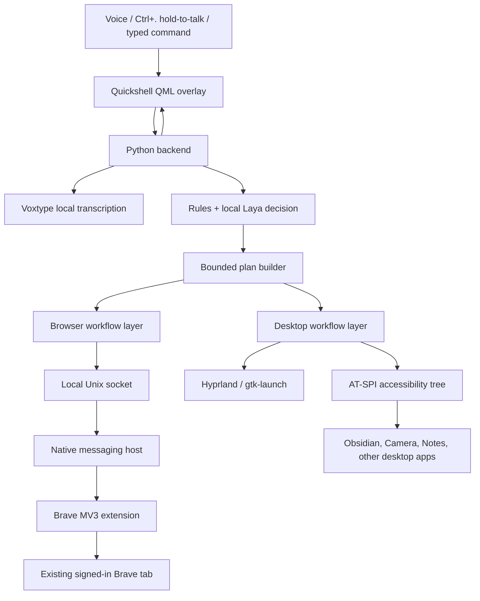

# Hyprash project handoff

## Initial target

Hyprash is a fully local, voice-first assistant for Arch Linux, Omarchy, and
Hyprland. It was visually inspired by `jevaiass.mp4`, but is not based on Jev
AI and does not use it. The product replaces any hosted assistant dependency
with local Voxtype speech recognition and the local Laya model.

The intended experience is a polished top-screen assistant overlay with
thinking orbs, a liquid animation that appears to originate near the camera
space, and an Omarchy-compatible box theme. It should control existing,
signed-in Brave tabs and desktop applications using natural commands, including
Google search, YouTube search and playback, Spotify search and playback,
GitHub navigation, Obsidian notes, Notes, and Camera.

No cloud API or API key is required.

## Architecture



The assistant uses bounded execution. Local Laya chooses from known tasks and
plans; it does not produce unrestricted shell commands or arbitrary desktop
actions.

Browser execution follows observe, act once, and verify. Desktop execution uses
Hyprland window information and AT-SPI controls, such as named buttons, text
fields, links, and menus.

## Workflow

1. The user holds `Ctrl+.` to speak and releases it to execute.
2. Voxtype transcribes speech locally.
3. The backend normalizes the utterance, identifies a supported workflow, and
   has local Laya approve or reject its bounded action.
4. The complete plan is validated before any side effect begins.
5. Each step observes state, targets a specific control or workflow, acts once,
   and verifies the expected outcome.
6. Progress, errors, cancellation, and execution state return to the QML UI.

This prevents the earlier failure mode of guessing page elements, repeating
clicks, or continuing after a failed first step.

## Folder structure

```text
hyprash/
├── hyprash.sh                 Launcher
├── README.md                  Setup and usage documentation
├── simular-similar.md         Simular-inspired phased capability report
├── handoff.md                 This document
├── requirements.txt           Python dependencies
├── jevaiass.mp4               Original visual reference
│
├── hyprash/                   Core Python application
│   ├── backend.py             Main orchestration and event loop
│   ├── speech.py              Voxtype transcription integration
│   ├── decision.py            Local Laya decision gate
│   ├── commands.py            Command normalization and routing
│   ├── workflows.py           Known browser/desktop workflows
│   ├── plans.py               Multi-step plan validation/execution
│   ├── browser.py             Browser bridge client
│   ├── desktop.py             Desktop control layer
│   └── themes.py              Theme loading
│
├── ui/                        Quickshell/QML interface
│   ├── shell.qml              Main assistant overlay
│   ├── LiquidSurface.qml      Liquid/camera-origin animation
│   ├── ThinkingOrb.qml        Individual thinking orb
│   ├── ThinkingOrbs.js        Orb animation logic
│   ├── Notes.qml              Embedded notes view
│   ├── CameraWindow.qml       Camera view
│   └── shaders/               Liquid and glow shaders
│
├── browser-extension/         Brave/Chrome Manifest V3 extension
│   ├── manifest.json
│   ├── background.js          Native bridge and tab coordination
│   ├── page.js                Semantic page observation/control
│   └── execution.js           Observe → act → verify behavior
│
├── scripts/
│   ├── browser_host.py        Native messaging host
│   ├── accessibility.py       AT-SPI desktop accessibility bridge
│   ├── ptt.py                 Push-to-talk support
│   └── check_*.py             Focused live checks
│
├── tests/
│   ├── test_*.py              Python unit and workflow tests
│   ├── browser_controls.mjs   Browser control integration tests
│   ├── browser_workflows.mjs  Browser workflow tests
│   └── execution.mjs          Extension execution tests
│
├── themes/
│   ├── omarchy.json           Main box-like Omarchy theme
│   └── liquid.json            Liquid visual variant
│
├── vendor/
│   ├── thinking-orbs/         Orbs implementation/adaptation
│   └── liquid-gooey/          Liquid visual assets
│
└── data/                      Local settings, notes, and vault selection
```

## Technology stack

| Area | Technology |
|---|---|
| Desktop environment | Arch Linux, Omarchy, Hyprland |
| Main backend | Python 3.12 |
| Speech recognition | Voxtype and a local speech model |
| Intent decisions | Laya 0.4.1, local CPU inference |
| UI | Quickshell, Qt Quick, QML, Qt Multimedia |
| Visual effects | QML Canvas, shaders, Gaussian/threshold goo effect |
| Browser integration | Brave Origin, Manifest V3 extension |
| Browser bridge | Native messaging and local Unix socket |
| Desktop controls | Hyprland `hyprctl`, `gtk-launch`, Linux AT-SPI |
| Browser tests | Node.js and Playwright |
| Python tests | `unittest` |

The visual system has the requested camera-space liquid reveal: it begins near
the camera/top origin, expands through liquid drops and gooey blending, and
settles into the assistant box. Thinking orbs are integrated into the top UI.

## Current progress

| Phase | Status | Delivered work |
|---|---|---|
| Core assistant | Complete | QML overlay, local transcription, Laya routing, themes, liquid motion, orbs, Ctrl+. interaction, browser and desktop foundations |
| Phase 1: reliable single actions | Complete | Browser observe → act → verify flow, trace output, cancellation, safer tab handling, known Google/YouTube/Spotify/GitHub workflows |
| Phase 2: multi-step plans | Complete | Whole-command validation before side effects, sequential execution, local Laya decision per step, stop on failure/cancel |
| Phase 3: current-screen semantic control | Implemented locally; Brave reload pending | Safer page controls, shadow-DOM discovery, stale-control protection, desktop control identity and owner-window checks |
| Phase 4: context and recovery | Complete | Five-minute Google/YouTube result context, repeated tab/URL validation, stale-context rejection |
| Phase 5: routines | Complete | Reusable workflows with explicit precondition checks (browser, vault, apps, notes) |
| Phase 6: polish and measurement | Remaining | Timing metrics, cancellation refinements, physical shortcut validation, motion tied to real execution state |

Phases 1 and 2 are documented in `simular-similar.md`.

## Implemented capabilities

- Local voice-to-command flow and typed commands.
- Local Laya decision gating without cloud services.
- Control of existing signed-in Brave tabs.
- Google searches and result opening.
- YouTube search plus first/second-result workflows.
- Spotify search/play workflows when Spotify exposes the needed controls.
- GitHub navigation workflows.
- Dedicated local Obsidian vault and note creation flow.
- Notes and Camera application launching.
- Omarchy and Liquid themes.
- Thinking orbs and liquid UI animation.
- Multi-step plans, validated before actions begin.

Phase 2 verification included 58 Python tests, browser execution and workflow
tests, browser-control checks, and offline Laya plan fixtures.

## Phase 3 checkpoint

Phase 3 is implemented locally and has passed its isolated test gate. Its
browser source is not active in the existing Brave session until the unpacked
extension receives a non-disruptive reload. Its changes include:

- Browser controls receive short-lived semantic identities based on name, role,
  editability, disabled state, and page identity.
- Open shadow-DOM controls can be discovered.
- A stale or replaced control fails safely instead of clicking a similar new
  target.
- Generic browser clicks and fills require fresh observation first.
- Desktop controls are tied to their owning window address, PID, title, and
  class.
- A selected desktop control is checked again before activation, preventing an
  action after the user changes windows.

The current Phase 3 test checkpoint passed 61 Python tests, extension execution
tests, browser workflow tests, browser control tests in headless Brave,
JavaScript syntax checks, and Python compilation checks. The first sandboxed
Playwright launch was blocked by Brave's crashpad socket restriction; the same
isolated fixture passed when run outside that sandbox.

Live checks exposed two current desktop constraints:

- Obsidian exposes only its top-level frame through AT-SPI on this machine, so
  arbitrary in-app controls cannot yet be safely automated through
  accessibility. Its direct note-creation workflow remains available.
- Camera exposes controls including “Take Picture,” but they are disabled in
  the current state, likely because the camera device or app state is
  unavailable. Hyprash correctly refuses to activate disabled controls.

The installed extension ping currently reports `phase1-observe-act-verify`, so
the running Brave service has not loaded Phase 3 yet. No user tab was navigated
solely to reload it.

## Phase 4: follow-up result context

Phase 4 adds safe follow-ups such as “open the second result.” A verified
Google or YouTube search stores only the active tab id, exact search URL, site,
query, and a monotonic timestamp. It does not store result labels, page text,
screenshots, browser history, or any persistent record.

The context expires after five minutes. Hyprash performs a read-only current
tab inspection before the request reaches Laya and repeats it immediately
before selecting a result. A tab switch, URL change, manual navigation, expiry,
new browser task, Stop command, or completed result selection clears context.
The extension independently checks the same tab and URL before navigating.

Phase 4 passed 65 Python tests, extension execution tests, browser workflow
tests, and isolated Brave browser-control tests. It deliberately does not
retry a stale result action: it asks for a new search instead.

## Phase 5: reusable routines with state validation

Phase 5 adds reusable, named multi-step routines with preflight state validation.
A routine has an explicit purpose, bounded input schema, starting conditions
(preconditions), and the same observe → act once → verify execution contract.

Preconditions check whether required resources are active before any action
runs:
- Browser connected check (`Precondition('browser')`) for web tasks.
- Obsidian vault check (`Precondition('vault')`) for Obsidian notes.
- Installed application check (`Precondition('app', target)`) for external tools.
- Notes availability check (`Precondition('notes')`).

If any precondition fails, execution halts immediately with an explanatory error,
producing zero side-effects.

Supported built-in routines include:
- `morning`: Search weather and open notes.
- `daily_standup`: Open notes and initialize a Daily Standup note.
- `focus`: Play focus music on Spotify and open notes.
- `code_review`: Navigate to GitHub and launch terminal.

User-defined routines can be persisted in `data/routines/<name>.json` after
strict schema validation against arbitrary code or unsafe verbs. Local Laya
evaluates routine triggers (e.g. `run morning routine`, `start daily standup`)
with high calibrated confidence (80–93%).

Phase 5 passed 94 Python tests, Node execution tests, browser workflow and
control tests, offline Laya plan and routine fixtures, and bridge tests.

## Phase 6: Natural Language Architecture, Tab Contract, DAG Recovery & Latency Profiling

Phase 6 upgrades Hyprash to handle conversational natural language, enforces an explicit tab-ID state contract between Python and the Brave MV3 extension, isolates sub-workflow execution across distinct domains with DAG dependencies, and introduces monotonic stage latency profiling.

### 1. Two-Tier Canonical Intent Resolver (`hyprash/nlu.py`, `hyprash/decision.py`)
- **Tier 1 (Deterministic Normalization & Slots):** Strips conversational prefixes (`"can you"`, `"could you"`, `"hey hyprash"`, `"i want you to"`) and suffixes (`"for me please"`, `"right now"`), preserving semantic entities (`"rock and roll"`, `"dungeons and dragons"`) and quotes. Normalizes verbs to canonical intents without incurring CPU latency.
- **Tier 2 (Semantic Fallback via Local Laya):** Unclassified conversational requests are resolved by local Laya 0.4.1 CPU inference upfront rather than in tight execution loops.
- **Typed Schemas:** Defines explicit dataclasses:
  - `ResolvedIntent`: `intent_type`, `entities`, `confidence`, `ambiguity_reason`, `requires_clarification`, `raw_text`, `normalized_text`, `action_kind`, `action_value`.
  - `ConversationContext`: Tracks `active_tab_id`, `active_site`, `last_intent`, `search_context` (5-minute TTL), `active_app`.
- **Under-specified Queries:** Queries like `"play something else"` without active media context return structured `ClarificationRequired` instead of guessing destructively.

### 2. Explicit Tab-ID Lifecycle Contract (`browser-extension/background.js`, `hyprash/browser.py`)
- **Tab Creation & Verification:** `new_tab` creates a tab, reads it back, confirms it is active, and returns `{ tab_id, url, status, active: true }`.
- **Output-to-Input Binding:** Multi-step plans pass the created `tab_id` from step 1 into step 2 (`target_tab_id`) so the search executes in that exact tab.
- **Follow-Up Tab Reuse:** If the active tab is a blank/new tab (`chrome://newtab/`, `about:blank`, `brave://newtab/`), subsequent searches reuse that active tab rather than spawning duplicates.
- **Version Handshake (`phase6-v1`):** Extension ping reports `phase6-v1`, while gracefully handling live sessions reporting `phase1-observe-act-verify`.

### 3. DAG Sequential Execution & Partial Recovery (`hyprash/plans.py`, `hyprash/backend.py`)
- **PlanStep Schema:** Subclasses `Action` with `step_id`, `target_domain` (`browser:youtube`, `browser:spotify`, `desktop:notes`), `depends_on`, `idempotency`, `preconditions`, `postconditions`, `on_failure` (`ABORT_DEPENDENT` vs `ABORT_ALL`), and bindings.
- **Domain Context Isolation:** In multi-domain compound plans (e.g. `"Open YouTube and play X, then open Spotify and play Y"`), a verification failure in YouTube halts YouTube-dependent steps but allows independent Spotify steps to proceed safely.
- **Execution Telemetry:** Populates `PlanExecutionReport` (`completed_steps`, `failed_steps`, `skipped_steps`, `overall_status`) and emits granular UI events (`step_started`, `acting`, `verifying`, `succeeded`, `failed`, `cancelled`).

### 4. Monotonic Latency Profiler (`hyprash/diagnostics.py`, `scripts/check_latency.py`)
- Measures monotonic nanoseconds (`StageTimer`) across:
  1. Voxtype STT (PTT-to-transcript)
  2. NLU Normalization & Slot Extraction
  3. Laya 0.4.1 CPU Inference (Tier 2)
  4. Plan & DAG Validation
  5. Action Dispatch (Act)
  6. Postcondition Verification
  7. Total End-to-End Latency
- Run with:
  ```bash
  ./scripts/check_latency.py --samples 5
  ./scripts/check_latency.py --json
  ```
- Benchmarks show warm median total latency of **~15 ms** for Tier 1 deterministic commands.

### 5. Safe Brave Extension Reload Instructions
To update the live Brave session to `phase6-v1`:
1. Open `brave://extensions` in Brave.
2. Locate the **Hyprash Browser Control** unpacked extension.
3. Click the **Reload** (circular arrow) icon.
4. Verify by running:
   ```bash
   .venv/bin/python -c "import hyprash.browser as b; print(b.ping())"
   ```
   It will report `{'connected': True, 'version': 'phase6-v1', ...}`.
*Note: Due to our backward-compatible version handshake, existing sessions reporting earlier versions continue to operate safely without errors.*

## Product boundary and risks

Hyprash is not yet unrestricted visual automation. It is designed around
semantic browser controls, known workflows, and AT-SPI desktop controls. This
keeps it from blindly interacting with changed pages and wrong windows.

Spotify and YouTube may change their UI, and signed-in account state can alter
available controls. Desktop control quality depends on each application’s
AT-SPI support. A later visual-selector capability should only be considered
after local feasibility and reliability testing.

